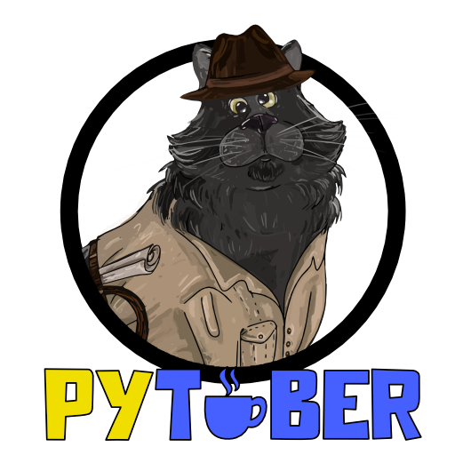

<p align="center">
  <a href="https://github.com/ademirj93/pytuber" rel="noopener">
    
  </a>
</p>

<h1 align="center">Pytuber Studio</h1>

<div align="center">

[](https://github.com/ademirj93/pytuber)
[](https://www.python.org/)
[](https://pyga.me/)
[](https://github.com/ademirj93/pytuber/releases)
[](https://github.com/ademirj93/pytuber/releases)
[](/LICENSE)

</div>

<p align="center">
  <b>Pytuber</b> é uma aplicação desktop moderna, leve e de alta performance para criação, personalização e streaming de avatares <b>PNGTuber / VTuber</b> 2D.
  <br>
  Inspirada no design profissional de ferramentas como <b>OBS Studio</b>, <b>Discord</b> e <b>Veadotube</b>.
</p>

---

## 📋 Sumário

- [Visão Geral](#-visão-geral)
- [Principais Funcionalidades](#-principais-funcionalidades)
- [Instalação e Execução](#-instalação-e-execução)
- [Como Configurar no OBS Studio](#-como-configurar-no-obs-studio)
- [Atalhos do Teclado e Navegação](#-atalhos-do-teclado-e-navegação)
- [Compilação e Criação do Instalador](#-compilação-e-criação-do-instalador)
- [Atualizador Automático (Auto-Updater)](#-atualizador-automático-auto-updater)
- [Registro de Alterações (Changelog)](CHANGELOG.md)
- [Autores e Licença](#-autores-e-licença)

---

## 🧐 Visão Geral

O **Pytuber Studio** permite dar vida ao seu avatar em transmissões ao vivo ou chamadas no Discord com processamento de áudio em tempo real. Ele detecta sua voz através de qualquer microfone configurado, alternando instantaneamente entre estados de fala e silêncio, além de simular movimentos orgânicos de respiração, oscilação e piscadas de olhos naturais.

---

## ✨ Principais Funcionalidades

### 🎨 1. Nova Interface Studio (Dark Mode Moderno)

- **Design System refinado:** Cores escuras de alto contraste (`#121216`, `#1C1C22`, `#26262E`) com bordas suaves e tipografia moderna em `Segoe UI`.
- **Layout em 2 Colunas:** Coluna esquerda para visualização do personagem em tempo real e controles principais; coluna direita para cartões agrupados de Sprites, Áudio e Ajustes de Renderização.
- **Preview em Tempo Real:** Área interativa que reage ao microfone na própria tela de configuração, sem precisar iniciar o modo de captura.

### 🎙️ 2. Motor Reativo por Áudio

- **Piscadas Orgânicas:** Algoritmo de piscada com intervalos variáveis aleatórios para máxima naturalidade.
- **Física de Respiração e Oscilação:** Movimentos sutis de respiração contínua e oscilação proporcional ao volume da fala.
- **Seletor de Microfones:** Menu flutuante de seleção de dispositivos de entrada com botão de atualização dinâmica (`↻`) e medidor de nível sonoro integrado ao controle de sensibilidade.

### 🎯 3. Sistema de Anchor Point (Ponto de Ancoragem)

- **Retícula de Ancoragem Central:** Marcador visual central no personagem base (`char`).
- **Alinhamento em Tempo Real:** Tanto na edição de posições quanto no guarda-roupa, linhas guias inteligentes conectam a âncora aos olhos, boca e acessórios, exibindo em tempo real as coordenadas relativas exatas `Δ (X, Y)`.

### 👗 4. Guarda-Roupa Completo (Wardrobe)

- **Categorias Agrupadas em Acordeão:** Organização por Chapéus, Acessórios, Camisas, Casacos, Calças, Maquiagem, Objetos de Cena e Cor dos Olhos.
- **Camadas em 1 Clique:** Alternância instantânea entre camadas de renderização: **Frente**, **Meio** e **Trás**.
- **Ajuste de Escala (Tamanho):**
  - Slider interativo com arraste suave diretamente na barra de preview.
  - Botões de ajuste fino `[-]` e `[+]` e atalho de restauração `1.0x`.
  - Controle via roda do mouse (_Scroll_) sobre a tela.
  - Controle numérico na janela de configuração do item.
- **Trava de Segurança (Lock):** Bloqueie itens para evitar que sejam arrastados acidentalmente durante o ajuste de outras peças.
- **Ícones Estilo Bootstrap Icons:** Botões de ação com lápis vetorial (`bi-pencil-fill`) para edição e lixeira (`bi-trash-fill`) para exclusão.

### 📹 5. Transparência Nativa e Câmera Virtual

- **Modo Sem Bordas e Transparente:** Fundo Chroma com corte automático via DirectShow / Windows Layered Window.
- **Compatibilidade com OBS Studio:** Suporte nativo à Captura de Jogo (_Game Capture_) com transparência Alpha perfeita.
- **Câmera Virtual Integrada:** Suporte à inicialização de webcam virtual via `pyvirtualcam` para envio direto a aplicativos como Discord, Zoom e Google Meet.

### 🔄 6. Atualizador Automático (Auto-Updater)

- **Verificação Assíncrona em Segundo Plano:** Consulta silenciosa à API do GitHub Releases na inicialização do app.
- **Modal Integrado:** Exibe notas da versão (_changelog_), versão atual vs. nova e botão de download.
- **Instalação em 1 Clique:** O instalador é baixado com barra de progresso em tempo real; ao concluir, o Pytuber é encerrado de forma limpa e o instalador é executado automaticamente.

---

## 🚀 Instalação e Execução

### Pré-requisitos

- **Windows 10** ou **Windows 11** (64-bit)
- **Python 3.14+** (recomendado: [Python 3.14.10](https://www.python.org/downloads/release/python-31410/)) ou Python 3.12 / 3.13

### 1. Clonar o Repositório

```powershell
git clone https://github.com/ademirj93/pytuber.git
cd pytuber
```

### 2. Criar e Ativar o Ambiente Virtual

```powershell
# Cria a venv com o Python 3.14
py -3.14 -m venv .venv

# Ativa a venv no PowerShell
.\.venv\Scripts\Activate.ps1
```

### 3. Instalar as Dependências

```powershell
pip install -r requirements.txt
```

### 4. Executar o Aplicativo

```powershell
python main.py
```

---

## 🎮 Como Configurar no OBS Studio

O Pytuber foi planejado para integrar-se ao **OBS Studio** com máxima eficiência e qualidade sem necessidade de plugins externos:

1. **No Pytuber:**
   - No painel direito, ative a chave **"Sem Bordas"** ou **"Transparente"** (com a cor Chroma desejada).
   - Clique em **▶ INICIAR** para entrar no modo de transmissão.
2. **No OBS Studio:**
   - Na lista de _Fontes_, adicione uma **Captura de Jogo** (_Game Capture_).
   - Em _Modo_, escolha **"Capturar janela específica"** e selecione `[Pytuber.exe]: Pytuber Studio`.
   - Marque a caixa de seleção **"Permitir Transparência"** (_Allow Transparency_).
   - _Pronto!_ O personagem estará recortado com nitidez total e sem consumir CPU excessiva.
3. **Para usar no Discord, Teams ou Meet:**
   - No próprio painel de Controles do OBS Studio, clique em **"Iniciar Câmera Virtual"**.

---

## ⌨️ Atalhos do Teclado e Navegação

| Tecla / Atalho      | Onde se aplica          | Ação                                                    |
| :------------------ | :---------------------- | :------------------------------------------------------ |
| `ESC`               | Modo RUNNING            | Retorna ao Menu principal do Studio                     |
| `ESC`               | Posições / Guarda-Roupa | Cancela e volta ao Menu principal                       |
| `Ctrl + Z`          | Posições / Guarda-Roupa | **Desfazer (Undo)** última alteração de posição ou item |
| `Setas Direcionais` | Posições / Guarda-Roupa | Ajuste fino de 1px da peça selecionada                  |
| `Shift + Setas`     | Posições / Guarda-Roupa | Ajuste rápido de 10px da peça selecionada               |
| `+` / `-`           | Guarda-Roupa            | Aumenta ou diminui a escala do acessório selecionado    |
| `Scroll do Mouse`   | Preview do Guarda-Roupa | Ajusta a escala do acessório selecionado                |
| `Scroll do Mouse`   | Modo de Posições        | Zoom geral do avatar                                    |
| `Tab`               | Modo de Posições        | Alterna entre Peça Base, Olhos e Boca                   |

---

## 📦 Compilação e Criação do Instalador

O projeto inclui um sistema de compilação automatizado via [build.py](file:///c:/Users/Ademir/Projetos/pytuber/build.py) e [setup.iss](file:///c:/Users/Ademir/Projetos/pytuber/setup.iss) (Inno Setup 7):

```powershell
# Compilação completa (PyInstaller + Inno Setup em 1 comando)
python build.py

# Ou no Windows, simplesmente dê dois cliques no arquivo:
.\build.bat
```

### O que o processo de build executa:

1. **Limpeza:** Remove compilações anteriores (`build/`, `dist/`).
2. **PyInstaller (`--onedir`):** Empacota a aplicação com ícone oficial, sem console preto de fundo, vinculando automaticamente todas as bibliotecas da `.venv`.
3. **Inno Setup 7:** Gera o instalador standalone compacto com compressão LZMA2 ultra:
   - Caminho de saída: `dist\installer\Pytuber_Setup_v0.9.0.exe`
   - Atalhos na Área de Trabalho e Menu Iniciar
   - Identificador único (`AppId` GUID) que permite que atualizações futuras sobrescrevam versões antigas de forma limpa.

---

## 🔄 Atualizador Automático (Auto-Updater)

O módulo [updater.py](file:///c:/Users/Ademir/Projetos/pytuber/updater.py) gerencia o ciclo de vida de atualizações:

1. Ao alterar `APP_VERSION = "0.10.0"` em `updater.py` e compilar via `build.bat`, o instalador gerado é nomeado `Pytuber_Setup_v0.10.0.exe`.
2. Ao publicar uma release no GitHub anexando esse instalador:
   - Os usuários que estiverem em versões anteriores verão o alerta **"Nova Versão Disponível"** ao abrir o app.
   - O aplicativo baixa o executável em segundo plano e inicia a instalação com 1 clique!

---

## ✍️ Autores e Contribuição

- **Ademir** ([@ademirj93](https://github.com/ademirj93)) — Criador e Desenvolvedor Principal

Contribuições, sugestões e relatórios de bugs são bem-vindos! Sinta-se livre para abrir uma _Issue_ ou enviar um _Pull Request_.

---

## 📄 Licença

Este projeto é distribuído sob a licença **MIT**. Consulte o arquivo [LICENSE](file:///c:/Users/Ademir/Projetos/pytuber/LICENSE) para mais detalhes.
